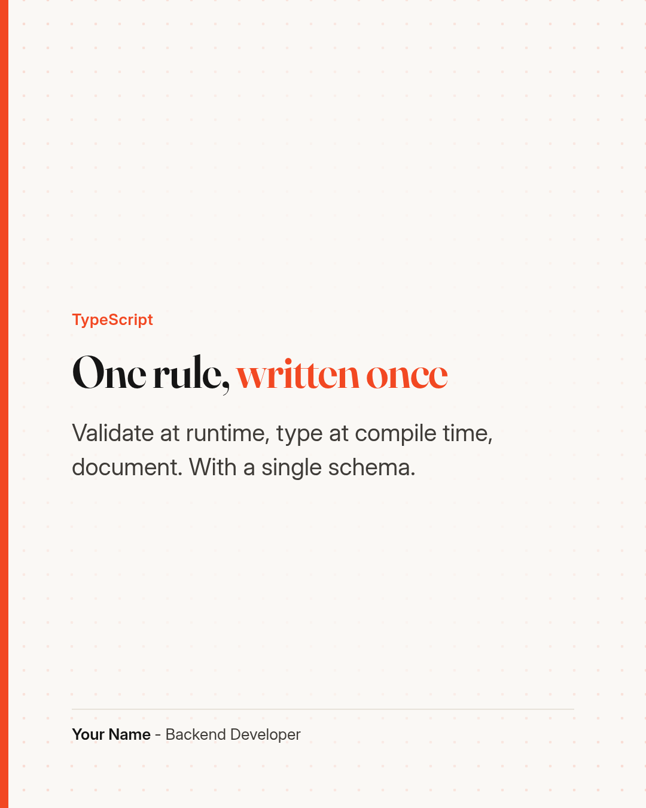
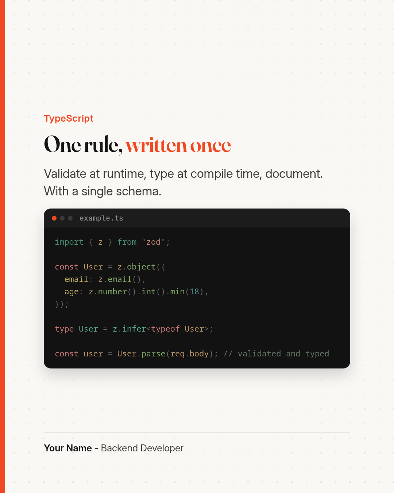

<p align="center">
  <picture>
    <source media="(prefers-color-scheme: dark)" srcset="brand/lockup-on-dark.svg">
    
  </picture>
</p>

# linkedin-scheduler

Write your LinkedIn posts in advance as Markdown files, give each one a clean image card, and let cron
publish them on your personal profile through LinkedIn's official API. No server, no web interface, no
third-party scheduler: a folder, two scripts and a cron line.

<p>
  
  
</p>

## What it does

- **Publishes on schedule.** Each run publishes at most one post: dated today, `status: ready`, whose
  time has come (09:00 by default). A post missed because your machine was off goes out at the next run;
  a post from a past day is never sent late.
- **Never posts twice.** A published file moves to `posts/posted/` with its link, every published text
  is remembered in `posts/ledger.json`, a post being sent is marked `publishing`, and a lock stops two
  runs from overlapping. A certain failure (network down, LinkedIn refuses) puts the post back to
  `ready`; an unknown outcome is left for you to check, never retried.
- **Makes post cards.** 1080×1350 images (LinkedIn's portrait format) from an HTML template: label,
  title with accent words, short text, optional technology logo and syntax-highlighted code sample, your
  signature. Colours and signature come from `config.toml`; text that does not fit is refused, not cut.
- **Writes LinkedIn-ready text.** `**the hook**` becomes Unicode bold (LinkedIn has no markup), links
  go in a first comment (`first_comment`), images and MP4 videos are uploaded with the post.
- **Checks before sending.** `--check` proves your token works, `--dry-run` shows exactly what would go
  out (and `--date` previews another day), limits are checked (3,000 characters, video size and length).

## Install with a coding agent

Open any coding agent at the root of a clone and paste the prompt from
[docs/AGENT_INSTALL.md](docs/AGENT_INSTALL.md) (everything below its line). The agent checks the repo,
sets up your cards, walks you through the LinkedIn app, prepares a first post and schedules publishing.
You keep the LinkedIn clicks and the token in your own hands, and nothing is published without your yes.

Prefer doing it yourself? The quick start below takes about fifteen minutes.

## Quick start

Requirements: Python 3.11+. For the image cards only: Node.js 18+ and Google Chrome or Chromium.

### 1. Set up LinkedIn (once, about 10 minutes)

LinkedIn gives no API key on its own: you create a small app on your account, then generate a token for
it. Everything is free and self-serve, and the posts go to **your personal profile**.

1. **Create the app** at <https://www.linkedin.com/developers/apps> → **Create app**: a name, any square
   logo, and a LinkedIn Page (required by LinkedIn; any Page you belong to, or an empty one you create).
   Skip the Page verification if you are not its admin.
2. **Add two products** in the app's **Products** tab: **Share on LinkedIn** (permission to post) and
   **Sign In with LinkedIn using OpenID Connect** (to read your member id). Both are instant.
3. **Generate a token** with the [token generator](https://www.linkedin.com/developers/tools/oauth/token-generator):
   pick your app, tick `openid`, `profile` and `w_member_social`, sign in, allow, copy the token.
4. **Put it in `.env`** with its expiry date (about 60 days from today):

   ```bash
   cp .env.example .env    # then set LINKEDIN_ACCESS_TOKEN and LINKEDIN_TOKEN_EXPIRES
   python3 scripts/publish.py --check
   # Token OK: <your name>
   # LINKEDIN_PERSON_URN=urn:li:person:...   <- paste this line into .env too
   ```

That is all the configuration publishing needs: with the token in `.env`, `publish.py` and cron work
directly. Renew the token every ~60 days (step 3 again; the log warns a week before). Step by step, with the Page
verification and renewal: [docs/linkedin-setup.md](docs/linkedin-setup.md).

### 2. Write a post

```bash
npm install                                                       # once, for the image cards
cp posts/texts/_example.md posts/texts/2026-10-27-1-my-topic.md   # edit date, text, card fields
python3 scripts/render_card.py posts/texts/2026-10-27-1-my-topic.md
python3 scripts/publish.py --dry-run --date 2026-10-27            # set status: ready when happy
```

### 3. Schedule it

`crontab -e`, for example Monday, Wednesday and Friday at 9:00, 13:00 and 18:00:

```
0 9,13,18 * * 1,3,5 /path/to/linkedin-scheduler/scripts/run.sh
```

Each run publishes at most one ready post of the day and logs to `logs/publish.log`.

## Documentation

| Guide | Covers |
|---|---|
| [Agent install](docs/AGENT_INSTALL.md) | The prompt for a coding agent to set everything up with you |
| [LinkedIn setup](docs/linkedin-setup.md) | Creating the LinkedIn app, getting and renewing the token |
| [Writing posts](docs/writing-posts.md) | The post file, its fields, bold hooks, links, media, slots |
| [Post cards](docs/cards.md) | Card fields, `config.toml`, logos, code samples, your own template |
| [Scheduling](docs/scheduling.md) | cron, slots and catch-up, what happens on failures |
| [Troubleshooting](docs/troubleshooting.md) | Common errors and how to fix them |

## Layout

```
posts/texts/      posts waiting to be published (files starting with "_" are ignored)
posts/posted/     published posts, with their link
posts/images/     cards, logos (images/logos/) and code samples (images/code/)
posts/videos/     videos used by posts
posts/ledger.json every published text (keep it in git: it is the duplicate guard)
scripts/          publish.py, render_card.py (+ two small Node helpers), run.sh for cron
template/         card.html and its fonts
config.toml       card colours, signature, Chrome path
tests/            python3 -m unittest discover tests
brand/            logo (symbol, lockups, light and dark), icon, GitHub social preview
```

## Limits

- LinkedIn only, personal profile only (company pages need LinkedIn's Community Management API review).
- The token lasts about 60 days; renewing it takes a minute (the script warns a week before).
- cron runs only when your machine is on: run it on a small always-on box if you need certainty.
- Reddit, X and others are not supported. Automating a social account through its web interface goes
  against those platforms' terms; this tool only uses LinkedIn's official API.

## License

MIT, see [LICENSE](LICENSE). Fonts: SIL Open Font License 1.1.
