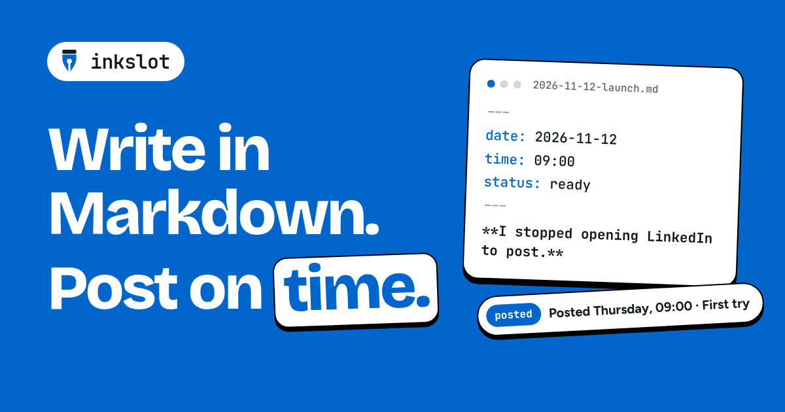

<p align="center">
  <a href="https://inkslot.makisend-poc.workers.dev">
    
  </a>
</p>

<p align="center">
  <a href="https://inkslot.makisend-poc.workers.dev"><b>Website</b></a> ·
  <a href="https://inkslot.makisend-poc.workers.dev/docs/"><b>Docs</b></a> ·
  <a href="https://inkslot.makisend-poc.workers.dev/deploy/"><b>Deploy guide</b></a> ·
  <a href="https://inkslot.makisend-poc.workers.dev/changelog/"><b>Changelog</b></a>
</p>

# inkslot

Write your LinkedIn posts as Markdown files in your own repo, push, and a Cloudflare Worker on **your
own account** publishes each one at its minute, through LinkedIn's official API. On the free plan: no
server, no subscription, and nobody else ever holds your posts or your token.

> inkslot was called `linkedin-scheduler`; the repository keeps that name for now. MIT licensed. Not
> affiliated with LinkedIn.

[](https://deploy.workers.cloudflare.com/?url=https://github.com/cjdotdev/linkedin-scheduler)

> **On the button's page:** tick **Create private Git repository** (your copy holds your posts, drafts
> included; it is unchecked by default), and give the Worker, the database and the KV namespace **names
> nothing on your account already has** (Cloudflare reuses an existing database with the same name).
> The [deploy guide](https://inkslot.makisend-poc.workers.dev/deploy/) gets the four values it asks for
> ready in your browser first.

## Watch

<p align="center">
  <a href="docs/media/inkslot-trailer.mp4">
    
  </a>
</p>
<p align="center"><sub>30 seconds, from a file to your profile. <a href="docs/media/inkslot-trailer.mp4">Full video with sound (MP4)</a>.</sub></p>

## How it works

```
git push ──► Workers Builds ──► D1 migrations ─► deploy the Worker ─► sync posts to D1, media to KV
cron * * * * * ──► Worker: earliest due post ─► LinkedIn (image or video, post, first comment) ─► D1 status
```

1. **Write.** A post is a Markdown file in `posts/texts/` with a small header: date, time,
   `status: ready`, optional image or video, optional first comment.
2. **Push.** Every push to your copy deploys the Worker and syncs your posts to a D1 database and your
   media to Workers KV, on your account, through Workers Builds. Only what changed is sent. No GitHub
   secrets.
3. **Posted.** Every minute, the Worker publishes the earliest post whose time has come, at most one per
   minute, then its first comment.

### Never twice

Posting the same text twice on your profile is worse than posting late, so every rule leans toward
safety:

- **Claimed before it's sent.** A post is claimed atomically before the Worker calls LinkedIn, so two
  runs can never send the same one.
- **Retried, inside its window.** A failed try is retried every minute for 10 minutes (9:00 … 9:10),
  then marked `failed` with LinkedIn's reason. A post pushed after its window is marked `missed`.
- **Unclear means stop.** If LinkedIn's answer is unclear, the post is marked `unknown` and never
  retried. You check, then you decide.
- **The same text, once.** The same text is never posted twice, and a posted post is never touched
  again by a sync.

### Yours

The repository, the database, the media, the token and the LinkedIn app are all on your accounts. The
project has no server and no telemetry, and you can read every line that touches your token.

## What you need

- A **Cloudflare** account (free plan, no card needed) and a **GitHub** (or GitLab) account.
- A **LinkedIn app** with *Share on LinkedIn*, and an access token: [docs/linkedin-setup.md](docs/linkedin-setup.md).
  About 5 minutes; LinkedIn requires a Company Page to create the app (an empty one works); the token
  lasts 60 days.

## Install

Three ways, same result ([docs/install.md](docs/install.md)):

1. **One click** (about 3 minutes): the button above. Cloudflare copies this repository into your
   GitHub, creates the database and the media store, writes their ids into your copy, asks for your four
   values, and deploys. Every later push to your copy redeploys and syncs.
2. **With your coding agent.** Paste [docs/AGENT_INSTALL.md](docs/AGENT_INSTALL.md) into any coding agent
   opened in a clone of your private copy. It sets everything up; you keep the LinkedIn clicks and your
   token.
3. **By hand.** `pnpm install && pnpm run setup`.

The four values:

| Value | What |
|---|---|
| `LINKEDIN_ACCESS_TOKEN` | Lets the Worker post as you, from your own LinkedIn app |
| `LINKEDIN_TOKEN_EXPIRES` | The day the token expires (`YYYY-MM-DD`); `/status` warns 7 days before |
| `ADMIN_TOKEN` | A long random string that protects `/status` and `/check` |
| `DRY_RUN` | `1` only logs what would be posted; `0` posts for real |

Then:

1. Set your timezone in `scheduler.json` (`"timezone": "Europe/Paris"`; `UTC` by default).
2. Write a post ([docs/writing-posts.md](docs/writing-posts.md)), push.
3. Check `GET /status` with your `ADMIN_TOKEN`.

For a first test, keep `DRY_RUN` at `"1"` in `wrangler.jsonc`: posts are marked `posted` with a fake link
and nothing reaches LinkedIn. Set it to `"0"` and push to post for real.

## A post

```markdown
---
date: 2026-11-12
time: 09:00
status: ready
visibility: PUBLIC
media: images/launch.png
first_comment: The repo is in the comments.
---
**I stopped opening LinkedIn to post.**

I write my posts on Sunday, in Markdown, in my editor.
```

`**The hook**` becomes Unicode bold (LinkedIn has no markup), and the 3,000-character limit is checked
before anything is sent.

## Media

| Media | Where it goes | Card needed |
|---|---|---|
| Images and videos up to 25 MB, in `posts/images/` or `posts/videos/` | Workers KV | no |
| A file already online | `media: https://...` | no |
| Videos over 25 MB (LinkedIn accepts up to 200 MB) | R2, optional ([install.md](docs/install.md#videos-over-25-mb)) | yes, Cloudflare asks for one to enable R2 |

## Routes

- `GET /`: health.
- `GET /status`: the queue, the history and the token's expiry (`Authorization: Bearer <ADMIN_TOKEN>`).
- `POST /check`: run the minute check now (same header).

## Statuses

`draft`, `scheduled`, `publishing`, `retrying`, `posted`, `failed`, `missed`, `unknown`, `cancelled`.
See [docs/scheduling.md](docs/scheduling.md) for what each one means.

## Limits

- **The LinkedIn token lasts 60 days** and cannot be refreshed automatically outside LinkedIn's partner
  programs. `/status` warns 7 days before `LINKEDIN_TOKEN_EXPIRES`; renewing takes 2 minutes.
- **Personal profile only.** Company pages need a LinkedIn partner permission.
- **To the minute**, and at most one post per minute.

## Docs

Also on the website: [inkslot.makisend-poc.workers.dev/docs](https://inkslot.makisend-poc.workers.dev/docs/).

| File | What |
|---|---|
| [docs/install.md](docs/install.md) | The three ways to install, deploying on every push, R2 for big videos |
| [docs/linkedin-setup.md](docs/linkedin-setup.md) | LinkedIn app, token, renewing it, what catches people out |
| [docs/writing-posts.md](docs/writing-posts.md) | The post format, timezone, editing and deleting posts |
| [docs/scheduling.md](docs/scheduling.md) | When posts go out, retries, statuses, the history, `DRY_RUN` |
| [docs/updating.md](docs/updating.md) | Getting new versions into your copy |
| [docs/troubleshooting.md](docs/troubleshooting.md) | What went wrong and how to fix it |
| [docs/AGENT_INSTALL.md](docs/AGENT_INSTALL.md) | The prompt for a coding agent |
| [AGENTS.md](AGENTS.md) | For contributors: layout, rules that must hold, commands |
| [brand/](brand/) | The inkslot mark, colours and rules |

## Development

```bash
pnpm install
cp .dev.vars.example .dev.vars          # add DRY_RUN=1: never posts for real
pnpm db:migrate:local && pnpm sync:local
pnpm dev                                # then: curl "localhost:8787/__scheduled?cron=*+*+*+*+*"
pnpm test && pnpm typecheck
```

`src/core/` holds everything that does not depend on Cloudflare (posts, scheduling rules, LinkedIn);
`src/cloudflare/` is the Worker (Hono routes, cron, D1, KV/R2). `scripts/` has the sync, the deploy
script and the setup. The scheduler's tests run its SQL on in-memory SQLite with a fake clock.

## v1

The first version (Python, run by cron on your own machine, with image cards) is on the
[`v1` branch](https://github.com/cjdotdev/linkedin-scheduler/tree/v1) and the `v1.0.0` tag.

## License

MIT, see [LICENSE](LICENSE).
